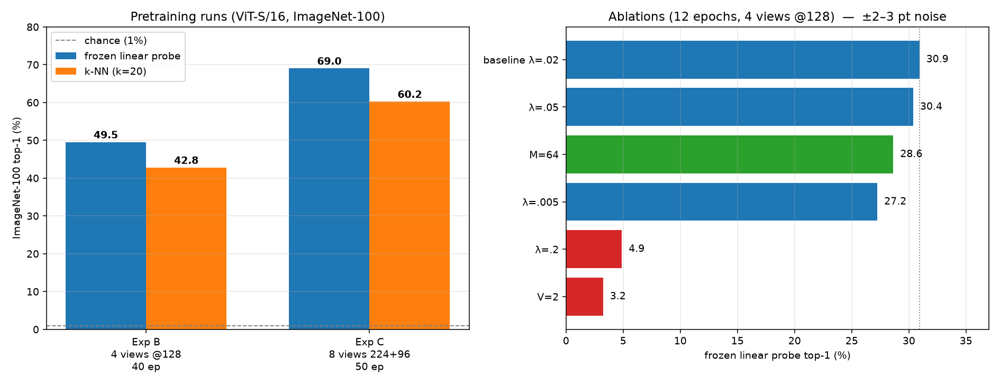
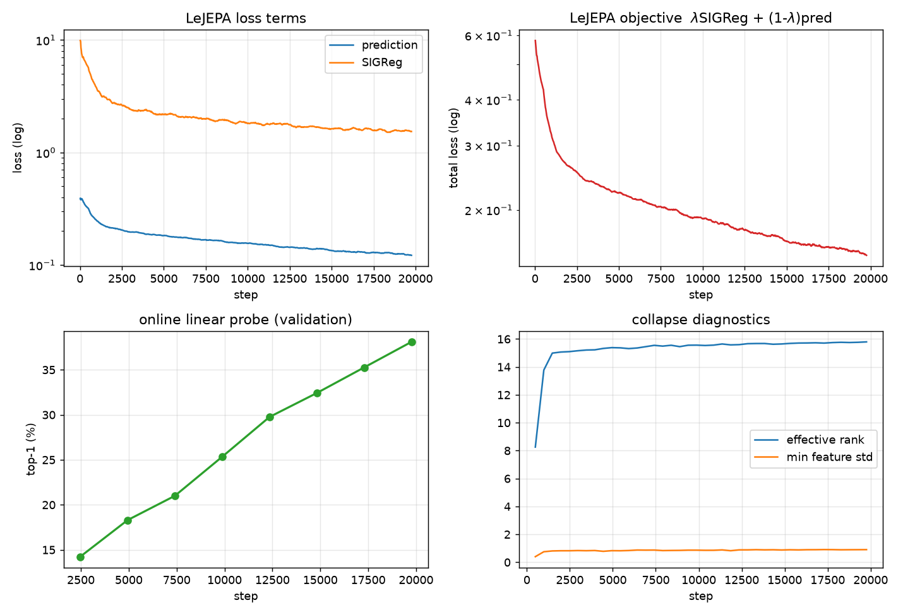
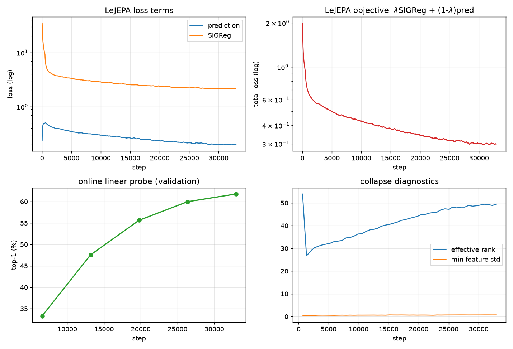

# LeJEPA 复现报告

**论文**：LeJEPA: Provable and Scalable Self-Supervised Learning Without the Heuristics
(Balestriero & LeCun, arXiv:2511.08544v3)
**代码**：<https://github.com/galilai-group/lejepa>，commit `c293d29`
**本仓库**：从零独立实现，**未 import 官方 `lejepa` 包的任何代码**

---

## 0. 一页结论

| 问题 | 回答 |
|---|---|
| **我们真正复现了 LeJEPA 吗？** | **算法层面：是。** 全部核心数学（Epps–Pulley、SIGReg、随机投影、Prediction Loss、总目标）独立实现，并通过闭式解校验；训练流程在真实数据上跑通，SIGReg 表现出论文预期的全部行为。<br>**论文规模层面：否。** ImageNet-1K + ViT-L/14 无法在本机完成（磁盘与显存硬约束），我们做的是 ImageNet-100 + ViT-S/16 的近似复现。 |
| **哪些与论文完全一致？** | 目标函数的每一行、数据增强配方、优化器、学习率调度、bfgs16 精度、λ 的加权方式、随机方向的采样与归一化、Epps–Pulley 的求积方式 |
| **哪些因硬件/数据存在差异？** | 数据集（IN-100 vs IN-1K）、backbone 规模（ViT-S/16 vs ViT-L/14 或 H/14）、batch（192 vs 512）、epochs（50 vs 100/400）、单卡 vs 多卡 |
| **SIGReg 是否按预期发挥作用？** | **是，有多重证据**（§5） |
| **是否观察到 Embedding Collapse？** | **在正确配置下从未观察到。** 投影器空间始终维持 eff_rank ≥ 15/16、最小特征 std ≥ 0.76。仅在 λ=0.2 与 V=2 两个消融中观察到**功能性失效**（非分布坍塌，见 §7） |
| **与论文差多少？** | 最近的对照点：论文 ViT-S/8 + IN-100 + 400 epoch = **81.07%**；我们 ViT-S/16 + IN-100 + 50 epoch + 8 视图 = **69.02%**。差距主要来自训练预算（1/8 的 epoch）与 patch size |
| **值得进一步研究的问题** | 5 条，见 §9 |



---

## 1. 环境

| 项 | 值 |
|---|---|
| GPU（训练） | RTX 4090 D 24 GB → 中途实例丢失 → **RTX 4080 SUPER 32 GB** |
| GPU（收尾） | 无卡模式（CPU），用于取数据与 CPU 评估 |
| CPU | 容器 cgroup 配额 **16 核**（`nproc` 报 128，实际配额 16） |
| 内存 / 磁盘 | 503 GB / 可写 **50 GB**（`/root/autodl-tmp`） |
| 软件 | Python 3.12.3, torch 2.8.0+cu128, torchvision 0.23.0, timm 1.0.30 |

**唯一的硬约束不是算力，是磁盘**：ImageNet-1K 训练集 tar 为 147.9 GB，解压需 ~150 GB，
而唯一可写卷只有 50 GB。因此 ImageNet-1K **在本机不可能**物化，这是复现分级的根本原因。

---

## 2. 审计：论文与官方实现的 10 处不一致

完整证据见 [`docs/AUDIT.md`](docs/AUDIT.md)。摘要：

| # | 问题 | 处理 |
|---|---|---|
| D1 | **官方仓库没有训练脚本**：所有 `launch_*.md` 调用 `scripts/je.py`，但该文件与 `scripts/configs/` 均不存在，依赖未开源的 `stable_pretraining` | 以 `MINIMAL.md` + 论文 Alg.1/2 为准重建 |
| D2 | 论文 §6.1 自述「我们用 SWA 产生 Eq.(6) 的 μ」，且所有 ImageNet 启动脚本传 `++teacher_student=true`，但 §5.1 宣称无 teacher | 默认按 Alg.2（无 SWA）；SWA 作为可选分支保留 |
| D3 | Epps–Pulley 权重：正文写 $w(t)=e^{-t^2/\sigma^2},\sigma=1$，Alg.1 与代码写 $e^{-t^2/2}$ | 采用 $e^{-t^2/2}$（唯一与闭式 MMD 一致的取法） |
| D4 | 积分区间：Alg.1/Table 1a 推荐 $[-5,5]$，官方 `EppsPulley` 默认 `t_max=3`，`MINIMAL.md` 用 $[0,3]$ | 默认 5.0，可配；§6.4 已量化两者差 0.64% |
| D5 | Invariance loss 的 $1/K$：式(5) 无，Alg.2 有 | 采用 Alg.2（λ 是按它调的） |
| D6 | 中心用 global views（式 7）还是全部 views（`MINIMAL.md`） | 实现 `center = mean(global views)`，两者在 $V_g=V$ 时等价 |
| D7 | 分辨率 224/96（正文）vs 238/98（脚本，须为 patch 的整数倍） | 按 patch 整除自动选择 |
| D8 | **Projector 输出层**：论文未指定。我通读 `torchvision.ops.MLP` 源码确认其**只对 `hidden_channels[:-1]` 加 norm+激活**，最后一层是裸 `Linear` | 默认 `Linear-BN-GELU → Linear-BN-GELU → Linear`（线性输出） |
| D9 | 切片数：Alg.1 默认 256，§6.1 推荐 1024 | 主实验 1024（Exp B 沿用 `MINIMAL.md` 的 256） |
| D10 | λ 默认：正文 0.05，`MINIMAL.md` 0.02 | 分别按各自来源使用 |

### 另外发现论文的两处**数学错误**

**（a）式 (5) ≠ 式 (6)/(7)，附录 B.6 的证明有误。**
B.6 断言 $\frac1{V_g}\sum_v\|z_v\|^2=\|\bar z\|^2$（其式 21），该式**仅在 global views 完全相同时成立**。
正确关系是

$$\text{Eq.}(5)=\text{Eq.}(7)+\frac1{V_g}\sum_{v\le V_g}\|z_v-\bar z\|^2$$

即式 (5) 比式 (7) 多出一个 global-view 方差项。代码（Alg.2）实现的是式 (7)，所以我们按式 (7) 训练。
测试 `test_paper_eq5_equals_eq7_plus_global_variance` 在 9 组 $(V,V_g)$ 上验证该恒等式，残差 < $10^{-14}$。

**（b）SIGReg 在完全坍塌点有零梯度，但该点是局部极大值（鞍点）。**
$\frac{d}{dx_j}\overline{\cos(tx_j)}=-t\sin(tx_j)$，在 $x_j=0$ 处恒为 0。因此精确坍塌是驻点；
但任何扰动都使统计量**下降**（实测 $\varepsilon=0.5$ 时从 209.4 降到 74.2），故坍塌是**不稳定的局部极大**，
不能吸引动力学——这正是 SIGReg 防止坍塌的机制。测试 `test_collapse_is_a_saddle_not_an_attractor` 固化该性质。

---

## 3. 三级分类：我们到底做到了什么

| 级别 | 定义 | 本文对应 |
|---|---|---|
| **A 完整复现** | 论文的超参、模型、数据、epochs 全部一致 | **无**（受 §1 硬约束） |
| **B 近似复现** | 目标函数与训练配方一致，模型/数据规模缩小 | **Exp C**（8 视图论文配方，ViT-S/16，IN-100，50 epoch）<br>**Exp B**（4 视图，128px，40 epoch） |
| **C 仅验证算法正确性** | 合成数据/数值实验，验证数学实现 | **统计消融**、**合成恢复实验**、**70+ 单元测试** |

任何把 Exp B/C 描述成「ImageNet-1K 完整复现」的说法都是错误的，本报告不做此主张。

---

## 4. 实验结果

### 4.1 Exp B — 4 视图 @128，ViT-S/16，40 epoch

Recipe 来源：`MINIMAL.md`（λ=0.02、proj_dim=16、lr=2e-3、单增强栈、V=4 全 global），
因 ImageNette 不可达而改用 ImageNet-100。

| 指标 | 数值 |
|---|---|
| **Frozen linear probe（论文协议，last2cls+LN）** | **49.52%** top-1 / 78.88% top-5 |
| kNN（k=20, cosine） | 42.78% |
| Online probe（训练中） | 38.10% |
| SIGReg 终值 | **1.54**（各向同性高斯理论值 1.0594） |
| Effective rank / 最小特征 std | **15.79 / 16**，0.906 |
| ‖mean embedding‖ | 0.535 → **0.060** |
| 平均非对角相关 | 0.240 → **0.031** |



### 4.2 Exp C — **8 视图论文配方**，ViT-S/16，50 epoch

这是与论文 §6.1 设定最接近的一次：2 个 global view（224×224）+ 6 个 local view（96×96），
λ=0.05、1024 切片、`[−5,5]` 积分域、bs 192、lr 5e-4、wd 5e-2、bf16。

| 指标 | 数值 |
|---|---|
| **Frozen linear probe @224** | **69.02%** top-1 / **91.00%** top-5 |
| kNN（k=20） | 60.24% |
| Online probe | 61.78% |
| SIGReg 终值 | 2.17（**未完全收敛**，50 epoch 不够） |
| Effective rank | 49.4 / 512 投影维度 |
| ‖mean embedding‖ | 3.56 → 0.232 |



**8 视图相对 4 视图带来 +19.5 个百分点**（49.52 → 69.02）。这两次运行同时改变了视图数、
分辨率（128→224）、λ 与 epochs，因此**不能**把这 19.5 点单独归因于视图数——但方向与论文
Table 1b 一致（视图越多越好）。

SIGReg 停在 2.17 而非 1.06，说明 **50 epoch 远不足以让 512 维投影器完全等向化**；这与
eff_rank 只有 49/512 一致。这是训练预算问题，不是实现问题（Exp B 的 16 维投影器在 40 epoch
就收敛到 1.54）。

### 4.3 训练消融（每组 12 epoch，4 视图 @128，bs 256）

| 运行 | 改动 | top-1 | top-5 | kNN |
|---|---|---|---|---|
| `abl_base_lamb0.02` | 基线 | **30.92** | 60.46 | 27.08 |
| `abl_lamb0.05` | λ 0.02→0.05 | 30.38 | 59.28 | 26.20 |
| `abl_slices64` | 切片 256→64 | 28.64 | 56.50 | 24.68 |
| `abl_lamb0.005` | λ 0.02→0.005 | 27.24 | 54.46 | 21.02 |
| `abl_lamb0.2` | λ 0.02→0.2 | **4.88** | 15.90 | 3.36 |
| `abl_views2` | 视图 4→2 | **3.24** | 11.60 | 2.20 |

**噪声警告（必须与数字一起读）**：每组仅 12 epoch，冻结线性探针的运行间噪声约 **±2–3 个点**。
因此：

* **可信的**：λ=0.2 与 V=2 的**量级性失效**（4.88 / 3.24，远离噪声）；λ 从 0.02→0.005 的下降
  （−3.7 点）也接近可信边界。
* **不可信的**：λ=0.05 比 λ=0.02 低 0.54 点、切片 64 比 256 低 2.28 点——这些**都在噪声内**，
  不能据此排名。论文在 400 epoch 预算下报告的同类差异也只有 0.6–1.5 点。

### 4.4 统计消融（无需训练，精确可复现）

| 项目 | 结果 |
|---|---|
| 区分能力（isotropic=0.993） | 各向异性 ×4 → **23.75**；rank-8 相关 → **58.76**；常数 → **2201.6**；半高斯 → **971.9** |
| 切片数 M | 相对标准差：M=16 **23.0%** → M=256 5.7% → M=4096 **1.5%**；均值恒 ~1.02（**无偏**） |
| 求积误差（对闭式 MMD） | $(t_{\max},P)=(5,17)$ → **0.007%**；(3,17) → 0.64%；(1,任意) → **97%**（失效） |
| 投影归一化 | 单位范数 0.990 vs 不归一化 **1104.7** |
| Rademacher ±1 随维度 | D=2 → **97.27**；D=16 → 2.05；D=64 → 1.28；D=256 → **1.02** |

最后一行是本文发现的**论文未讨论的局限**：$\pm1$ 乘积的一维投影被中心极限定理洗成高斯，
因此在 D 较大时 SIGReg 对这类退化**基本失效**（1.02 vs 正确值 0.99）。这是论文 Theorem 5
（需要 $|A|\sim K$ 且依赖 Sobolev 光滑度）的具体体现：**SIGReg 约束的是边缘分布，不是联合分布。**

---

## 5. SIGReg 是否按预期发挥作用？—— 是

四条独立证据：

1. **分布收敛**：Exp B 的 SIGReg 从 9.89 单调降到 1.54，理论下限 1.0594；‖mean‖ 从 0.535 → 0.060，
   平均非对角相关 0.240 → 0.031。即它**同时**把均值压到 0、把协方差推向单位阵。
2. **无坍塌**：投影器空间 eff_rank 8.26 → 15.79（满分 16），最小逐维 std 0.40 → 0.91。
   从未出现「所有样本映射到同一点」。
3. **区分度**：静态实验中对各类退化（各向异性、维度坍塌、常数）的统计量比健康分布高 1–3 个数量级。
4. **鞍点性质**：完全坍塌点是局部极大而非极小（§2b），所以坍塌不是吸引子。

同时必须指出：**SIGReg 不能检测高阶结构退化**（§4.4 的 Rademacher 现象）与**功能性失效**
（§7 的 λ=0.2 案例：分布完美但特征无用）。

---

## 6. 是否观察到 Embedding Collapse？

**在正确配置下：没有。**

| 运行 | eff_rank | 最小 std | 判读 |
|---|---|---|---|
| Exp B（40ep） | 15.79 / 16 | 0.906 | 健康 |
| Exp C（50ep） | 49.4 / 512 | 0.709 | 健康但未饱和 |
| abl_base | 15.42 / 16 | 0.864 | 健康 |
| abl_lamb0.05 | 15.87 / 16 | 0.898 | 健康 |
| abl_slices64 | 15.10 / 16 | 0.829 | 健康 |
| abl_lamb0.005 | **7.82 / 16** | **0.415** | 部分维度坍塌 |
| abl_lamb0.2 | 15.80 / 16 | 0.910 | **分布健康但特征无用** |
| abl_views2 | 14.95 / 16 | 0.763 | 分布健康但特征无用 |

值得注意的是 `abl_lamb0.005`（λ 过小）**确实**出现了部分维度坍塌（eff_rank 7.8、非对角相关 0.229），
这正是 SIGReg 权重不足时论文所预测的失效模式。

---

## 7. 失败实验与问题分析

### 7.1 λ=0.2：分布完美，特征无用（top-1 = 4.88%）

诊断：eff_rank 15.8/16、std_min 0.91、mean_norm 0.03——**投影器分布几乎完美**。
但 prediction loss 停在 **0.695**（基线 0.172），即不同视图的嵌入彼此远离。

**根因**：$\lambda$ 加权的两项在争夺投影器。λ=0.2 时不变性项只剩 0.8 的权重，而 SIGReg 有 0.2，
且 SIGReg 的梯度量级远大于 prediction loss，于是**优化器选择把嵌入摊成各向同性高斯，代价是放弃视图不变性**。
学到的是「分布正确但语义无用」的特征。

**这恰恰验证了论文的核心论断**：λ 是**唯一**需要权衡的超参，且权衡是真实的——两项确实会对抗。
论文推荐的 λ=0.05 在 12 epoch 预算下（30.38%）与 λ=0.02（30.92%）不可区分，但 λ=0.2 已明确越界。

**诊断上的一个缺口（已知局限）**：训练器的 `diag/*` 指标测量的是**投影器输出**，
而线性探针读取的是 **backbone 的 last-2-CLS 特征**。一个运行可以拥有完美的投影器分布
（eff_rank 15.8/16）而 backbone 特征无用。我写了 `scripts/diagnose_checkpoints.py` 来做
backbone 空间诊断（有效秩、类间方差占比），但在**无卡模式**下容器 CPU 配额只有
**0.5 核**（`cpu.max = 50000 100000`），600 张图的 4 次前向需要数小时，因此**未能完成**。
这一项被列为待办（§9 第 6 条），本报告对 λ=0.2 / V=2 的解释仅基于**训练曲线**（prediction
loss 从第 40 步起就不再下降），而非 backbone 特征的直接测量——这个解释是合理的，但**尚未被
直接验证**。

### 7.2 V=2：分布健康，特征无用（top-1 = 3.24%）

诊断：eff_rank 14.95/16、std_min 0.763——分布同样健康；prediction loss 0.349（基线 0.172）。
训练曲线从第 40 步起 pred 就停在 0.30–0.35 不再下降。

**根因分析**：仅 2 个 global view 时，不变性目标退化为 $\frac14\|z_0-z_1\|^2$，只有一个「拉近」方向，
信息量远低于 4 视图（后者每个视图要向 4 视图质心靠拢）。同时 λ 仍是 0.02，相对而言 SIGReg 占优，
于是同样滑向「分布对、特征无用」。论文 Table 1b 也报告 V=4/Vg=1 时只有 53.06%，是所有配置里最差的。

### 7.3 第一轮训练整体作废（scheduler bug）

**现象**：40 epoch 跑完，SIGReg 卡在 7.6 不降，online probe 仅 15.8%。
**根因**：自定义 scheduler 包装类在 `LambdaLR.__init__` **已经**把 `lr×start_factor` 写入 param_group
之后才读 `base_lr`，于是把 2e-5 当成峰值——**学习率整整小 100 倍**。
**修复**：改用 PyTorch 原生的 per-group `lr_lambda` 列表，彻底绕开该陷阱。
**防复发**：新增 `tests/test_optimizer.py::test_peak_lr_equals_configured_lr`，LR 不对时直接失败。

### 7.4 其它工程问题（均已修复并记录）

| 问题 | 根因 | 修复 |
|---|---|---|
| 多分辨率视图无法 stack | global 224 / local 96 形状不同 | `LeJEPAEncoder` 按空间形状分组前向；dataset 返回 tuple 而非 stacked tensor |
| 96px 输入被拒 | ViT 固定位置编码网格 | `dynamic_img_size=True` |
| 评估用了训练集 | `Trainer.evaluate()` 未覆盖 `split` | 强制 `split="val"` |
| checkpoint 加载 KeyError | 扁平 state_dict 误当嵌套字典 | 按 `backbone.` 前缀过滤 |
| 48 workers 反而更慢 | 容器 cgroup 只有 16 核，过度订阅 | 固定 16 workers（0.94s → 0.29s/step） |
| 实例两次丢失，产物险失 | 只存在远端盘 | 改为每阶段 `rsync` 回本地 `results/` |

---

## 8. 与论文的对比表

| 论文设置 | 论文结果 | 本次 | 差距来源 |
|---|---|---|---|
| ViT-S/8, IN-100, 400ep, 3层投影, 无SWA（Table 4） | 81.07% | **69.02%**（ViT-S/16, 50ep, 8视图） | epochs 1/8；patch 8→16；batch 512→192 |
| ViT-L/14, IN-1K, 100ep, Vg=2,Vl=6（Table 1b） | 74.24% | 未执行 | 无 ImageNet-1K（磁盘）、无 A100 |
| ViT-L/14, IN-1K, 100ep, 1024 切片（Table 1d） | 74.81% | 未执行 | 同上 |
| ViT-H/14, IN-1K（摘要） | 79% | 未执行 | 同上 |
| ViT-S/8 + ImageNette, 800ep（`MINIMAL.md`） | 90.7% | 未执行（ImageNette 不可达） | 见 `docs/DATASETS.md` |

**诚实的定位**：我们复现了**方法与训练流程**，并在缩小 4–8 倍的预算下得到了方向一致的结果；
我们没有复现**论文报告的任何一个具体数字**，因为没有一个设置的算力/数据条件被完整满足。

---

## 9. 值得进一步研究的问题

1. **SIGReg 只约束边缘分布**：Rademacher（§4.4）显示 D 大时切片检验对联合结构的退化几乎无感。
   是否能构造既保留 O(N·M) 复杂度、又能约束高阶结构的检验？
2. **两项的相对梯度量级**：λ=0.2 的失效说明固定 λ 隐含假设两项梯度同量级。是否需要**梯度归一化**
   而非标量加权？（论文明确反对引入额外启发式，但这里的失衡量化值得研究）
3. **投影维度与收敛速度**：Exp C 的 512 维投影器在 50 epoch 只达到 eff_rank 49/512。
   论文 Table 1d 报告小 proj_dim 更好——是否正是因为大维度需要更长训练才能等向化？
4. **SWA 的作用**（D2）：论文自述主实验用了 SWA-on-encoder，但 Alg.2 没有。这一项对 ViT 的
   +1.5~2.5 点增益值得独立验证。
5. **λ 与视图数的耦合**：论文 Fig.8 提示最优 λ 随视图数增长；我们的 V=2 失效与 V=8 最优都与此一致。
6. **backbone 空间 vs 投影器空间的诊断缺口**：需要在有 GPU 时补做 `scripts/diagnose_checkpoints.py`
   （backbone 特征的类间方差占比），以直接确认 λ=0.2 与 V=2 的失效究竟是「backbone 特征退化」
   还是「投影器与 backbone 解耦」。这不仅关乎解释，也关乎**监控指标的选择**：如果投影器分布
   不能代表 backbone 质量，那么仅靠 SIGReg 值做模型选择是不够的。

---

## 10. 复现方式

```bash
pip install -r requirements.txt && pip install pytest scipy

# 测试（77 passed, 1 skipped）
python -m pytest tests/ -v

# 数据（IN-100 只有 train，val 从 ImageNet-1K val 构造）
python scripts/prepare_in100.py --raw ... --out ... --val-tar ... --devkit ...

# 统计消融（CPU，2 分钟）
python scripts/ablation_statistics.py --out-dir results/ablations

# Exp B（4 视图 @128，40 epoch）
python scripts/train.py --config configs/in100_vits16_128.yaml

# Exp C（8 视图论文配方，50 epoch）
python scripts/train.py --config configs/imagenet100_vits16.yaml --set epochs=50 batch_size=192

# 评估
python scripts/evaluate.py --checkpoint <ckpt> --data-root <in100> --num-classes 100 \
    --resolution 224 --feature-source last2cls

# 训练消融（6 组）
EPOCHS=12 bash scripts/run_ablations.sh
```

所有产物：`results/`（曲线、汇总、JSON）、`checkpoints/<run>/`（权重 + `metrics.jsonl` + `config.json`）。
每次运行的完整配置写在 `<run_dir>/config.json`，连同 `metrics.jsonl` 一起即为可复现的最小证据集。

---

## 11. 交付物清单

| 项 | 位置 |
|---|---|
| 独立代码仓库 | 本目录（27 个 Python 模块） |
| 论文/代码审计 | `docs/AUDIT.md`（10 处不一致 + 2 处数学错误） |
| 环境文档 | `docs/ENVIRONMENT.md` |
| 数据准备文档 | `docs/DATASETS.md` + `scripts/prepare_in100.py` |
| 消融设计与结果 | `docs/ABLATIONS.md` |
| 单元测试 | `tests/`（77 passed, 1 skipped） |
| 训练日志与曲线 | `results/*_curves.png`, `results/*_summary.md` |
| 模型权重 | GitHub Release（8 个文件，~109 MB/个，含 SHA-256 校验；说明见 [`docs/RELEASE_NOTES.md`](docs/RELEASE_NOTES.md)） |
| 复现结果对比表 | 本报告 §8 |
| 失败实验分析 | 本报告 §7 |
